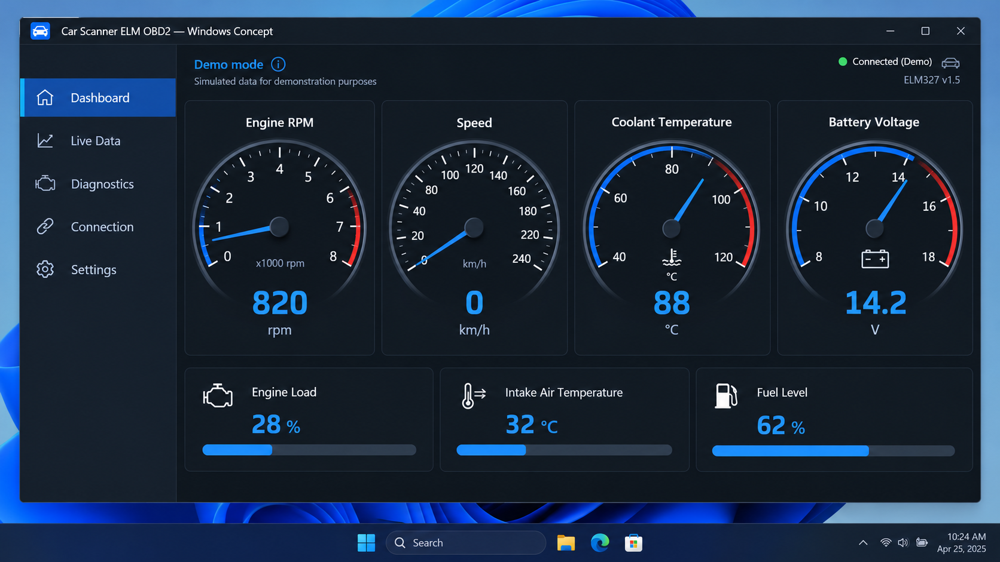
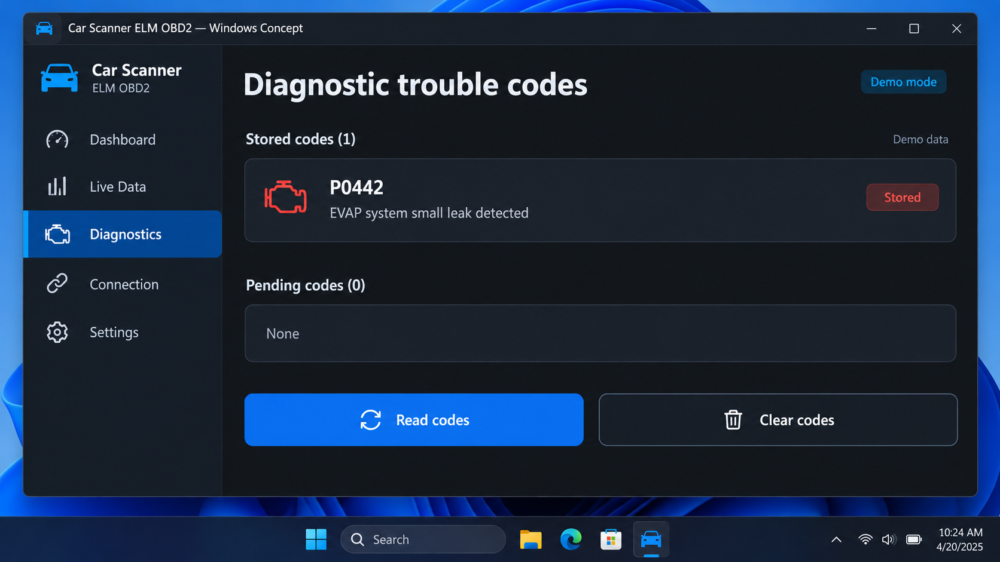
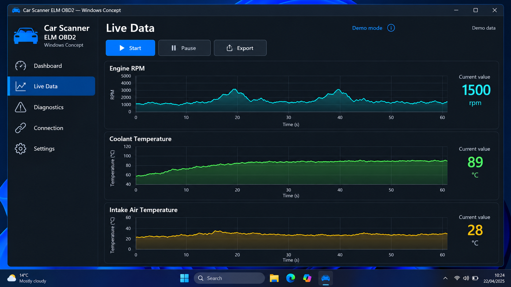

# Car Scanner ELM OBD2 - Android Vehicle Diagnostics

Car Scanner ELM OBD2 is an Android vehicle-diagnostics project from Car Scanner ELM. It communicates with an ELM327-compatible OBD-II adapter, reads ECU parameters, monitors live vehicle data, retrieves fault codes, and clears supported diagnostic trouble codes.

[](https://car-scanner-elm.github.io/car-scanner-elm-obd2/elm-obd2)



## Notice

Car Scanner ELM OBD2 is intended for diagnostics, maintenance, testing, and education. Vehicle support varies by manufacturer, model, ECU, adapter, and implemented OBD-II protocol.

### What is car scanner elm OBD2?

Car Scanner ELM OBD2 is a Java-based Android diagnostic application that connects to a vehicle through a compatible ELM327 Bluetooth adapter. The adapter plugs into the vehicle’s OBD-II port and translates commands between the Android device and its ECUs.

The Car Scanner ELM OBD2 repository contains command implementations for engine, fuel, pressure, temperature, protocol, and diagnostic-control data. Its Android layer manages configuration, Bluetooth communication, command jobs, progress events, and fault-code screens. The project uses streams to keep OBD command processing separate from the underlying connection.

## Prerequisites

- A vehicle with an OBD-II diagnostic port.
- An ELM327-compatible Bluetooth adapter.
- An Android device with Bluetooth support.
- A Java Development Kit suitable for the configured Gradle project.
- An Android SDK and Android build environment.
- A correctly paired adapter with its serial connection available.
- The vehicle ignition switched to the state required by its manufacturer.

## Features

### Connection types

- Bluetooth communication through [BluetoothManager.java](src/main/java/com/github/pires/obd/reader/io/BluetoothManager.java).
- Gateway-based command execution through [ObdGatewayService.java](src/main/java/com/github/pires/obd/reader/io/ObdGatewayService.java).
- Mockable gateway behavior through the retained abstract communication layer.
- Automatic protocol selection using [SelectProtocolCommand.java](src/main/java/com/github/pires/obd/commands/protocol/SelectProtocolCommand.java).

### Functionality

- Read stored, pending, and permanent diagnostic trouble codes.
- Clear supported fault codes.
- Read engine RPM, speed, load, runtime, throttle position, and temperature.
- Read fuel level, fuel trim, fuel pressure, fuel type, and consumption data.
- Read intake pressure, barometric pressure, module voltage, and timing advance.
- Retrieve the vehicle identification number when supported.
- Discover available PID ranges.
- Configure ELM327 echo, headers, spaces, line feeds, protocol, and timeout behavior.
- Report unsupported commands, missing data, bus initialization failures, and connection errors.



### Is car scanner elm OBD2 good?

Car Scanner ELM OBD2 provides a substantial standard OBD-II command layer and separates command parsing from Android communication. That structure is useful for common diagnostics such as reading live values, checking the malfunction indicator state, examining trouble codes, and clearing supported codes.

Its practical quality still depends heavily on the adapter and vehicle. Low-quality ELM327 clones may report misleading firmware versions, omit protocols, disconnect, or return malformed responses. Manufacturer-specific coding, DPF procedures, and advanced ECU programming are not implied by the standard command classes in this repository.

A car scanner elm obd2 review should therefore consider the vehicle, adapter, protocol, and required functions rather than the interface alone. Car Scanner ELM OBD2 is strongest when used for standard diagnostic services exposed by the vehicle.

## Supported devices

| Device | Connection | Typical configuration | Notes |
|---|---|---:|---|
| ELM327 Bluetooth adapter | Bluetooth serial | 38400 baud | Recommended starting point |
| ELM327-compatible adapter | Bluetooth serial | Adapter-dependent | Protocol and command support vary |
| ELM327 emulator | Virtual or bridged serial link | Environment-dependent | Useful for controlled testing |
| OBD-II vehicle ECU | CAN or legacy OBD protocol | Automatic selection | Available PIDs vary by vehicle |

The car scanner elm obd2 compatible adapters are devices that correctly implement the ELM327 command set and expose a usable serial connection. Adapter compatibility does not guarantee that every PID is implemented by the vehicle.

The car scanner elm obd2 vehicle compatibility depends on standard OBD-II availability and the protocols represented by [ObdProtocols.java](src/main/java/com/github/pires/obd/enums/ObdProtocols.java). The application can query supported PID ranges before requesting live values.

### How much does the ELM OBD2 car scanner cost?

The Car Scanner ELM OBD2 repository does not define a purchase price. Source availability and licensing are governed by [LICENSE](LICENSE), while the physical ELM327 adapter is a separate purchase.

The car scanner elm obd2 cost therefore depends mainly on the selected adapter and distribution channel. The car scanner elm obd2 price may also differ between a basic application edition and an optional Car Scanner ELM OBD2 Pro offering. No specific store price is claimed here because pricing can change by platform, region, and release.

## Installation

Use the included Gradle wrapper from the repository root.

```shell
./gradlew build
```

On Windows:

```powershell
.\gradlew.bat build
```

The build is configured through [build.gradle](build.gradle), [settings.gradle](settings.gradle), and [gradle.properties](gradle.properties). Automated Android checks are defined in [.github/workflows/android.yml](.github/workflows/android.yml).

### Is car scanner elm OBD2 free?

The Car Scanner ELM OBD2 source in this repository can be reviewed under the terms stated in [LICENSE](LICENSE). The repository itself does not require a payment value or contain a checkout system.

A separately distributed Car Scanner ELM OBD2 Pro edition may use different commercial terms. Hardware is also separate: an ELM327-compatible adapter must normally be obtained independently. Users should verify the current terms of their chosen application distribution and adapter seller.

## Basic Usage

1. Locate the vehicle’s 16-pin OBD-II port.
2. Insert a compatible ELM327 adapter.
3. Switch the ignition on without starting the engine unless the vehicle procedure requires otherwise.
4. Pair the adapter with the Android device.
5. Open Car Scanner ELM OBD2 and select the paired adapter.
6. Allow Car Scanner ELM OBD2 to reset and configure the interface.
7. Let the application select an OBD protocol automatically.
8. Query available PIDs before opening live-data views.
9. Read fault codes before deciding whether they should be cleared.
10. Disconnect Car Scanner ELM OBD2 before removing the adapter.

A typical ELM327 initialization sequence disables response formatting that can interfere with parsing and then selects the protocol:

```text
ATZ
AT E0
AT L0
AT S0
AT H0
AT SP 0
```

The car scanner elm obd2 setup is managed through [ConfigActivity.java](src/main/java/com/github/pires/obd/reader/activity/ConfigActivity.java) and [ObdConfig.java](src/main/java/com/github/pires/obd/reader/config/ObdConfig.java). The primary application flow is implemented by [MainActivity.java](src/main/java/com/github/pires/obd/reader/activity/MainActivity.java).

## Commands

| Group | Examples | Implementation |
|---|---|---|
| Engine | RPM, load, runtime, throttle position | [RPMCommand.java](src/main/java/com/github/pires/obd/commands/engine/RPMCommand.java) |
| Temperature | Coolant, intake, ambient air | [EngineCoolantTemperatureCommand.java](src/main/java/com/github/pires/obd/commands/temperature/EngineCoolantTemperatureCommand.java) |
| Fuel | Level, trim, pressure, air-fuel ratio | [FuelLevelCommand.java](src/main/java/com/github/pires/obd/commands/fuel/FuelLevelCommand.java) |
| Pressure | Barometric, manifold, rail pressure | [IntakeManifoldPressureCommand.java](src/main/java/com/github/pires/obd/commands/pressure/IntakeManifoldPressureCommand.java) |
| Diagnostics | Stored, pending, and permanent codes | [TroubleCodesCommand.java](src/main/java/com/github/pires/obd/commands/control/TroubleCodesCommand.java) |
| Vehicle information | VIN and supported commands | [VinCommand.java](src/main/java/com/github/pires/obd/commands/control/VinCommand.java) |
| Protocol | Reset, timeout, headers, PID discovery | [AvailablePidsCommand.java](src/main/java/com/github/pires/obd/commands/protocol/AvailablePidsCommand.java) |

Commands derive from [ObdCommand.java](src/main/java/com/github/pires/obd/commands/ObdCommand.java). Multiple operations can be represented through [ObdMultiCommand.java](src/main/java/com/github/pires/obd/commands/ObdMultiCommand.java), while persistent requests use [PersistentCommand.java](src/main/java/com/github/pires/obd/commands/PersistentCommand.java).

The car scanner elm obd2 read fault codes flow uses the diagnostic command layer and [TroubleCodesActivity.java](src/main/java/com/github/pires/obd/reader/activity/TroubleCodesActivity.java). The car scanner elm obd2 clear fault codes operation is represented by [ResetTroubleCodesCommand.java](src/main/java/com/github/pires/obd/commands/protocol/ResetTroubleCodesCommand.java).

## Scanner Coverage

car scanner elm obd2, car scanner elm obd2 android, car scanner elm obd2 bluetooth connection, car scanner elm obd2 read fault codes, car scanner elm obd2 live data, car-diagnostics, obd2, elm327, vehicle-diagnostics, automotive, ecu, fault-codes, live-data, bluetooth-obd2

## Troubleshooting

### The adapter does not connect

Confirm that the ELM327 adapter is powered, paired, and not connected to another device. Verify the selected Bluetooth device and try the adapter’s expected baud rate. Many adapters start at 38400 baud, but clones may use another rate.

The Car Scanner ELM OBD2 Bluetooth connection reports failures through exceptions such as [UnableToConnectException.java](src/main/java/com/github/pires/obd/exceptions/UnableToConnectException.java) and [BusInitException.java](src/main/java/com/github/pires/obd/exceptions/BusInitException.java).

### The application reports no data

A successful connection does not mean every PID is supported. Query the available PID ranges and request only commands advertised by the ECU. [CommandAvailabilityHelper.java](src/main/java/com/github/pires/obd/utils/CommandAvailabilityHelper.java) supports this check.

A no-data response is represented by [NoDataException.java](src/main/java/com/github/pires/obd/exceptions/NoDataException.java). Malformed numeric responses are handled by [NonNumericResponseException.java](src/main/java/com/github/pires/obd/exceptions/NonNumericResponseException.java).

### Responses contain unexpected text

Reset the adapter, disable echo, line feeds, spaces, and headers, and then select the protocol again. These operations are implemented by the protocol command classes, including [EchoOffCommand.java](src/main/java/com/github/pires/obd/commands/protocol/EchoOffCommand.java), [LineFeedOffCommand.java](src/main/java/com/github/pires/obd/commands/protocol/LineFeedOffCommand.java), and [HeadersOffCommand.java](src/main/java/com/github/pires/obd/commands/protocol/HeadersOffCommand.java).



### Coding and DPF procedures

The retained Car Scanner ELM OBD2 code focuses on standard OBD-II commands. The car scanner elm obd2 coding guide and car scanner elm obd2 dpf searches may refer to manufacturer-specific procedures that are not represented by the standard command set listed here. Do not assume those operations are available merely because basic diagnostics connect successfully.

## Architecture

```text
Android activities
        |
Gateway and Bluetooth services
        |
OBD command jobs
        |
Command and response parsing
        |
ELM327 protocol commands
        |
Vehicle ECU
```

The Android interface starts in [MainActivity.java](src/main/java/com/github/pires/obd/reader/activity/MainActivity.java). Communication is coordinated by [AbstractGatewayService.java](src/main/java/com/github/pires/obd/reader/io/AbstractGatewayService.java), with individual requests represented by [ObdCommandJob.java](src/main/java/com/github/pires/obd/reader/io/ObdCommandJob.java).

The command layer abstracts the transport as input and output streams. Protocol commands prepare the ELM327 interface, sensor commands parse live data, and exception classes classify failures without tying command parsing directly to the Android Bluetooth implementation.

## Testing

Run the Gradle checks with:

```shell
./gradlew build
```

The Car Scanner ELM OBD2 Android workflow is defined in [.github/workflows/android.yml](.github/workflows/android.yml). Hardware testing should cover multiple vehicles and adapters because supported commands and response timing differ between ECUs.

Before clearing codes, record the original diagnostic information. Test connection recovery, unsupported PIDs, missing responses, malformed responses, protocol selection, and adapter disconnection.

## Contributing

Contributions to Car Scanner ELM OBD2 should preserve the separation between Android communication and OBD command parsing. New PID implementations should follow the existing command hierarchy, validate malformed responses, and document the expected units and formulas.

Changes should avoid unsafe manufacturer-specific writes unless their behavior, vehicle scope, and risks are clearly established. Car Scanner ELM welcomes focused improvements to adapter compatibility, fault-code handling, live-data interpretation, and connection reliability.

## License

See [LICENSE](LICENSE).
